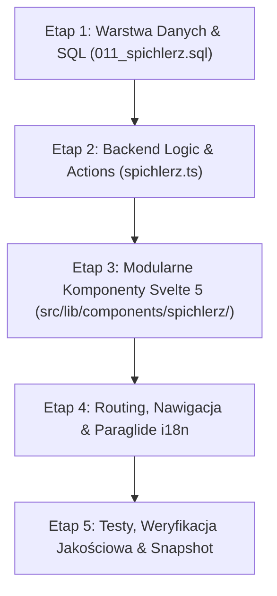

# Plan Implementacji: Moduł „Spichlerz” (*Lemiesz Second Brain / Evernote*)
*(Implementation Plan: "Spichlerz" — Lemiesz Sovereign Second Brain & Deliberation Granary)*

> **Dokument:** Plan Architektoniczny i Etapy Realizacji (Archival & Actionable — Zweryfikowany Audytem Kodu)  
> **Lokalizacja:** `docs/00_Architect_Exchange/2026-11-01_Plan_Implementacji_Spichlerz_Second_Brain.md`  
> **Data:** 2026-11-01 (Rev 2.0 — Post-Audit & Enhanced)  
> **Właściciele:** Lead Architect, Antigravity AI, Claude Code  
> **Status:** WDROŻONO I ZWERYFIKOWANO (Implemented & Verified — All Gates GREEN)  
> **Zgodność z Kanonem:** [docs/00_Canon/02_Architecture_Manifesto.md](../00_Canon/02_Architecture_Manifesto.md) oraz [AGENTS.md](../../AGENTS.md)

---

## 1. Geneza, Tożsamość i Cele Projektu

### 1.1. Dlaczego „Spichlerz”?
W doktrynie *Przymierza Lemiesza* **Spichlerz** to symbol suwerenności materialnej i intelektualnej. Podobnie jak gmina musi posiadać spichlerz ze zbożem, by przetrwać blokadę i kryzys (Doktryna Jeża §4 — Komórkowość Gospodarcza), tak zespół Lemiesza musi posiadać **Spichlerz Myśli, Narad i Zadań** — wewnętrzny Drugi Mózg (*Second Brain*), który nie zależy od zewnętrznych korporacji chmurowych (Evernote, Notion, Google Keep).

### 1.2. Problemy obecnego stanu (`/meetings`)
1. **Brak ergonomii Evernote:** Obecny moduł `/meetings` to tradycyjna lista pionowa. Wymaga scrollowania i przechodzenia między formularzem a listą.
2. **Konieczność 3-panelowej pracy równoległej:** Nowoczesny Drugi Mózg wymaga jednoczesnego widoku:
   * **Panel 1 (Przegrody):** Notesy/Kategorie + Tagi + Licznik ToDo,
   * **Panel 2 (Spis):** Lista notatek z błyskawicznym FTS5 search-as-you-type,
   * **Panel 3 (Warsztat):** Czytnik/Edytor z natychmiastowym odhaczaniem zadań checkboxami.
3. **Pojedynczy dom dla myśli i narad:** Połączenie notatek ze spotkań operacyjnych (np. po milczeniu posła Brauna), analiz kulturowych z Kuźni Myśli (np. Grechuta — *Korowód*), oraz podręcznego ToDo w jednym, centralnym punkcie aplikacji.

---

## 2. Inwarianty Architektoniczne (`AGENTS.md`)

Każdy etap wdrożenia musi bezwzględnie przestrzegać reguł z `AGENTS.md`:
* **Reguła 2.1 (The 150-Line Guardrail):** Zakaz tworzenia komponentów powyżej 150 linii. Strona nadrzędna `+page.svelte` musi być zwięzłym orkiestratorem (<80–100 linii). Wszystkie podkomponenty muszą być rozbite do `src/lib/components/spichlerz/`.
* **Reguła 2.3 (Modern Svelte 5 Runes Only):** Wyłącznie `$state()`, `$derived()`, `$props()`, `$effect()` oraz snippety. Zakaz przestarzałych store'ów Svelte 3/4.
* **Reguła 3 (Data Model Recycling & Zero Duplication):** Nie tworzymy osobnej bazy. Recyklingujemy i rozszerzamy istniejącą tabelę `meeting_minutes` oraz indeks `fts_meetings`, łącząc notatki kluczami obcymi z `correspondence_threads`, `media_assets` i `sources`.
* **Reguła 4 (FTS5 & Paraglide i18n):** Wyszukiwanie pełnotekstowe w SQLite ze standaryzacją `unicode61 remove_diacritics 2`. Każdy napis w UI zsynchronizowany w `messages/pl.json` i `messages/en.json`.
* **Reguła 5 (Bramki Weryfikacji):** Wszystkie 3 bramki (`pnpm check`, `pnpm test`, `pnpm db:snapshot`) muszą pozostać zielone.

---

## 3. Szczegółowy Plan Wdrożenia w Etapach



---

### ETAP 1: Warstwa Danych i Migracja SQL (`011_spichlerz.sql`)

**Cel:** Wzbogacenie modelu danych o atrybuty nowoczesnego Drugiego Mózgu przy zachowaniu 100% kompatybilności z istniejącymi protokołami (`009_meeting_minutes.sql`), testami bazowymi (`corpus.baseline.test.ts`) i procedurą `restore-drill.mjs`.

1. **Utworzenie migracji `src/lib/server/migrations/011_spichlerz.sql`:**
   * Dodanie kolumny `is_pinned INTEGER NOT NULL DEFAULT 0` (przypinanie kluczowych notatek i rejestru zadań na górze listy).
   * Dodanie kolumny `color_tag TEXT NOT NULL DEFAULT 'zinc' CHECK(color_tag IN ('zinc', 'amber', 'purple', 'blue', 'emerald', 'rose'))` (kategoryzacja wizualna: grafit, bursztyn, purpura, szafir, szmaragd, rubin).
   * Dodanie pełnych relacji kanonicznych zgodnie z Regułą 3 (`AGENTS.md`):
     * `media_id INTEGER REFERENCES media_assets(id) ON DELETE SET NULL` (łączenie notatek z utworami/obrazami z bazy mediów i Kuźni, np. Grechuta),
     * `source_id INTEGER REFERENCES sources(id) ON DELETE SET NULL` (łączenie z traktatami, Pismem Świętym i Konwencją Haską).
   * Dodanie indeksów wydajnościowych: `idx_meeting_minutes_pinned ON meeting_minutes(is_pinned DESC, meeting_date DESC)` oraz `idx_meeting_minutes_media ON meeting_minutes(media_id)`.
   * Wstępne oznaczenie istniejących rekordów kanonicznych: ustawienie `is_pinned = 1, color_tag = 'purple'` dla narady ws. posła Brauna (`id = 1`) oraz `is_pinned = 1, color_tag = 'amber'` dla *Podręcznego rejestru zadań (Backlog)* (`id = 2`).
2. **Przebudowa FTS5 (`fts_meetings`) z uwzględnieniem zadań i agendy:**
   * **Wniosek z audytu kodu:** W `009_meeting_minutes.sql` tabela wirtualna `fts_meetings` indeksowała wyłącznie `(title, summary, body, attendees, tags)`, pomijając `agenda` oraz `action_items_json`. Przez to wyszukiwanie zadań z Backlogu (np. *„Niemen”*, *„Fakir”*, *„8 listopada”*) nie zwracało wyników!
   * W `011_spichlerz.sql` należy wykonać `DROP TRIGGER` (`fts_meetings_ai`, `fts_meetings_ad`, `fts_meetings_au`), `DROP TABLE fts_meetings`, a następnie odtworzyć tabelę wirtualną `fts_meetings` rozszerzoną o `agenda` i `action_items_json`, odtworzyć triggery i obowiązkowo wykonać:
     ```sql
     INSERT INTO fts_meetings(fts_meetings) VALUES('rebuild');
     ```
     Dzięki temu tabela cieni `fts_meetings_docsize` zgadza się co do wiersza z `meeting_minutes` (warunek konieczny dla `scripts/restore-drill.mjs` linia 104 oraz `src/lib/server/corpus.baseline.test.ts` linia 53).
3. **Synchronizacja bazy i snapshotu (`baseline.sql`):**
   * *Uwaga z audytu:* `scripts/db-snapshot.mjs` posiada już `meeting_minutes` na liście `BASELINE_TABLES` (linia 29) i dynamicznie odczytuje nowe kolumny przez `PRAGMA table_info(meeting_minutes)`.
   * Uruchomienie migracji, wygenerowanie nowego zrzutu `pnpm db:snapshot` i weryfikacja testem `pnpm vitest run src/lib/server/corpus.baseline.test.ts`.

---

### ETAP 2: Backend Logic & Server Actions (`src/lib/server/meetings.ts` & `spichlerz.ts`)

**Cel:** Czyste, przetestowane API backendowe obsługujące operacje Spichlerza bez duplikacji kodu z istniejącym modułem `src/lib/server/meetings.ts`.

1. **Unifikacja `src/lib/server/meetings.ts` i `src/lib/server/spichlerz.ts`:**
   * **Wniosek z audytu kodu:** `src/lib/server/meetings.ts` jest już używany przez `/shield` (`listMeetingsForThread`) oraz `meetings.test.ts`. Aby nie duplikować zapytań SQL (Reguła 3 — Zero Duplication), rozszerzamy model w `meetings.ts` (lub czynimy `spichlerz.ts` modułem głównym i re-eksportujemy funkcje w `meetings.ts` dla pełnej kompatybilności wstecznej).
   * Rozszerzenie interfejsu `ActionItem` o opcjonalne pole `completed_at?: string` (obecne już w `data/baseline.sql` w wierszu 2!).
   * Rozszerzenie funkcji i zapytań:
     * `listSpichlerzEntries(filter: { category?, thread_id?, media_id?, source_id?, tag?, q?, isPinned?, hasOpenTasks?, limit? })`: pobieranie z FTS5 i `LEFT JOIN` do `correspondence_threads`, `correspondence_letters`, `media_assets` oraz `sources`. Sortowanie: `ORDER BY m.is_pinned DESC, m.meeting_date DESC, m.id DESC`.
     * `getSpichlerzEntry(id)`: pobieranie notatki wraz z metadanymi powiązanego wątku korespondencji, utworu muzycznego/wideo (`media_assets`), źródła (`sources`) oraz powiązanej analizy w Kuźni (`kuznia_deliberations`).
     * `toggleActionItem(entryId, taskIndex)`: natychmiastowa zmiana stanu pojedynczego zadania ToDo wewnątrz JSON z automatycznym zapisem daty `completed_at`.
     * `togglePin(entryId)` oraz `updateColorTag(entryId, colorTag)`: szybkie przypinanie/odpinanie notatki i zmiana koloru znacznika.
     * `quickCapture({ text, mode: 'task' | 'note', category?, assignee?, due_date?, created_by? })`:
       * **Ulepszenie ergonomii:** W dotychczasowym `createMeeting()` pola `summary`, `body` i `attendees` były sztywno wymagane (rzucały wyjątek przy braku). W Spichlerzu szybka notatka (`mode = 'note'`) automatycznie wylicza `summary` z pierwszych 160 znaków `body` i ustawia domyślnego autora (`attendees = created_by || 'Notatka własna'`), natomiast `mode = 'task'` dopisuje zadanie do przypiętego Backlogu.
     * `listAllTags()`: agregacja unikalnych tagów ze wszystkich wpisów wraz z licznikami wystąpień dla Panelu 1.
2. **Testy jednostkowe (`src/lib/server/meetings.test.ts` / `spichlerz.test.ts`):**
   * Pokrycie testami: sortowania `is_pinned DESC`, wyszukiwania FTS5 wewnątrz `action_items_json` (np. szukanie po treści zadania ToDo), relacji z `media_id` i `source_id`, `togglePin`, oraz `quickCapture`.

---

### ETAP 3: Warstwa UI — Modularne Komponenty Svelte 5 (`src/lib/components/spichlerz/`)

**Cel:** Budowa 3-panelowego interfejsu inspirowanego Evernote, z rygorystycznym limitem <120–150 linii na komponent oraz dopasowaniem do siatki `src/routes/+layout.svelte`.

> [!IMPORTANT]
> **Korekta układu z audytu `+layout.svelte`:** Główny kontener `<main>` w aplikacji posiada klasę `max-w-7xl xl:pr-72` (ze względu na pływający prawy panel nawigacyjny o szerokości `w-64` na ekranach `xl+`). Na ekranie `1280px` realna szerokość robocza `<main>` wynosi ok. `940px`. Dlatego sztywne kolumny `240px + 340px` zostawiłyby tylko `360px` na edytor!
> **Rozwiązanie:** Zastosowanie elastycznych proporcji siatki (`xl:grid-cols-[190px_260px_minmax(0,1fr)] 2xl:grid-cols-[220px_310px_minmax(0,1fr)]`) oraz dodanie przycisku **Trybu Skupienia (Zen Mode)**, który pozwala jednym kliknięciem zwinąć lewe panele podczas pisania długich protokołów.

1. **Struktura katalogu `src/lib/components/spichlerz/`:**
   * **`SpichlerzLayout.svelte` (<95 linii):**
     * Zarządca widoku 3 paneli na Desktopie z obsługą `zenMode` (zwijanie Panelu 1+2).
     * Na urządzeniach mobilnych i tabletach (`<xl`): inteligentny przełącznik zakładek/widoków (`Przegrody` / `Spis` / `Warsztat` lub `Radar Zadań`).
   * **`SpichlerzSidebar.svelte` (<115 linii):**
     * Przycisk główny `+ Nowa notatka w Spichlerzu`.
     * Przełącznik specjalny: **⚡ Radar Zadań (Wszystkie Otwarte ToDo)** z licznikiem oczekujących zadań ze wszystkich notatek (aby nie utracić globalnego widoku zadań z dawnego `/meetings`).
     * Filtry kategorii (Notesy): *Wszystkie, Polemiki i Listy, Strategia, Doktryna, Kampania, Operacyjne, Ogólne* z licznikami wpisów.
     * Chmura tagów z liczbą wystąpień (`#braun`, `#retencja`, `#korowod`).
   * **`SpichlerzList.svelte` (<115 linii):**
     * Pasek wyszukiwania FTS5 (szukający w tytułach, treści ORAZ w zadaniach ToDo).
     * Podział na sekcję `📌 Przypięte` oraz `🕒 Pozostałe wpisy`.
     * Wskaźnik aktualnie otwartej notatki i szybki filtr po tagu.
   * **`SpichlerzCard.svelte` (<85 linii):**
     * Pojedynczy kafelek wpisu: kolorowy pasek boczny (`color_tag`), data, tytuł, ikona przypięcia, skrót treści, odznaki powiązań (Listy / Kuźnia / Źródło) oraz postęp zadań (np. `2/4 zadań`).
   * **`SpichlerzWorkspace.svelte` (<130 linii):**
     * Górny pasek narzędziowy notatki: przełącznik `Podgląd / Edycja`, przycisk przypięcia (`togglePin`), wybór koloru (`color_tag`), przycisk `Tryb Skupienia (Zen)` oraz usuwanie wpisu.
     * Pasek powiązań kanonicznych: bezpośrednie linki do wątku w `/shield?tab=dossier` (np. Korona/Braun), dzieła w `/kuznia` (np. Grechuta) lub źródła w `/repository`, oraz most „Przekuj w Szkic (`/content`)”.
     * Renderowany Markdown (`marked`) z obsługą tabeli i cytatów.
   * **`SpichlerzEditorModal.svelte` lub inline edytor (<135 linii):**
     * Czysty formularz tworzenia/edycji wpisu z wyborem kategorii, koloru, powiązania z listem (`correspondence_threads`), utworem (`media_assets`) lub źródłem (`sources`).
   * **`SpichlerzActionItems.svelte` (<110 linii):**
     * Dedykowana sekcja zadań ToDo w otwartej notatce ORAZ obsługa widoku globalnego **Radaru Zadań**.
     * Checkboxy oparte o SvelteKit `use:enhance` z aktualizacją optymistyczną (`$state`) — kliknięcie natychmiast przekreśla zadanie bez przeładowania strony i zapisuje zmianę w SQLite.
     * Szybki formularz dodawania kolejnego zadania bezpośrednio do bieżącej notatki.
   * **`SpichlerzQuickCapture.svelte` (<75 linii):**
     * Pasek błyskawicznego zrzutu myśli (Quick Capture) na górze Spichlerza: pozwala jednym kliknięciem zapisać szybkie zadanie ToDo do Backlogu LUB utworzyć szybką notatkę z pomysłem/linkiem.

2. **Orkiestrator trasy `src/routes/spichlerz/+page.svelte` (<95 linii):**
   * Wyłącznie orkiestracja stanu (`data`, `selectedEntryId`, `viewMode`, `zenMode`, `editingEntry`).
   * Składanie powyższych komponentów w jedną spójną całość zgodnie z Regułą 2.1 (`AGENTS.md`).

---

### ETAP 4: Routing, Nawigacja, Integracja z Tarczą/Kuźnią i Paraglide i18n

1. **Routing i kompatybilność wsteczna (`/spichlerz` & `/meetings`):**
   * Nowa dedykowana trasa: `src/routes/spichlerz/+page.svelte` oraz `src/routes/spichlerz/+page.server.ts`.
   * Stara trasa `src/routes/meetings/+page.server.ts` otrzymuje przekierowanie `redirect(302, '/spichlerz' + url.search)` (z zachowaniem parametrów URL takich jak `?thread_id=1` lub `?category=epistolary`!).
   * Aktualizacja linków w `src/routes/shield/+page.svelte` (linie 733 i 748), aby prowadziły bezpośrednio do `/spichlerz?thread_id=...`.
2. **Nawigacja w `src/routes/+layout.svelte`:**
   * **Zastąpienie** dotychczasowej pozycji `/meetings` pozycją `/spichlerz` w tablicy `nav` (linia 43), aby uniknąć duplikacji w bocznym menu:
     * Ikona: `Archive` z `lucide-svelte/icons/archive` (lub `Warehouse` / `ScrollText`).
     * Etykieta: `m.nav_spichlerz()`.
3. **Uzupełnienie Paraglide i18n (`messages/pl.json` & `messages/en.json`):**
   * Rejestracja kompletnych, symetrycznych kluczy w obu plikach językowych:
     * `nav_spichlerz`: `"Spichlerz"` / `"Granary"`,
     * `spichlerz_title`: `"Spichlerz Myśli i Narad"` / `"Granary of Thought & Minutes"`,
     * `spichlerz_subtitle`: `"Suwerenny Drugi Mózg: notatki strategiczne, protokoły narad, analizy i rejestr zadań"` / `"Sovereign Second Brain: strategic notes, deliberations, analyses and task backlog"`,
     * `spichlerz_search_placeholder`: `"Szukaj w notatkach i zadaniach (FTS5)…"` / `"Search notes and tasks (FTS5)…"`,
     * `spichlerz_pinned`: `"Przypięte"` / `"Pinned"`,
     * `spichlerz_all_notes`: `"Wszystkie wpisy"` / `"All entries"`,
     * `spichlerz_todo_radar`: `"Radar Zadań (ToDo)"` / `"Task Radar (ToDo)"`,
     * `spichlerz_zen_mode`: `"Tryb skupienia"` / `"Focus mode"`,
     * `spichlerz_linked_media`: `"Powiązane dzieło / medium"` / `"Linked media asset"`,
     * `spichlerz_linked_source`: `"Powiązane źródło kanoniczne"` / `"Linked canonical source"`,
     * itd.
   * Kompilacja: `pnpm paraglide`.

---

### ETAP 5: Weryfikacja Jakościowa i Finalizacja

1. **Bramka 1 (`pnpm check`):** Weryfikacja statyczna TypeScript + Svelte 5 runes (`0 errors, 0 warnings`).
2. **Bramka 2 (`pnpm test`):**
   * Uruchomienie pełnego pakietu testowego (`vitest`), w tym nowych testów Spichlerza i testów spójności korpusu.
3. **Bramka 3 (`pnpm db:snapshot` & baseline test):**
   * Wygenerowanie zaktualizowanego `data/baseline.sql` (z nagłówkiem `-- baseline-migration: 011_spichlerz.sql`) i potwierdzenie spójności testem `pnpm vitest run src/lib/server/corpus.baseline.test.ts`.
4. **Kompilacja produkcyjna (`pnpm build`):**
   * Sprawdzenie poprawności bundlingu SSR i adaptera Node.

---

## 4. Raport z Audytu Kodu i Wprowadzone Ulepszenia (Rev 2.0)

Poniższa tabela podsumowuje wyniki weryfikacji planu względem faktycznego stanu repozytorium `lemiesz` (stan na migrację `010_kuznia.sql`):

| Obszar Audytu | Wykryte Ryzyko / Rozbieżność w Planie v1.0 | Wprowadzona Korekta i Ulepszenie w Planie v2.0 |
| :--- | :--- | :--- |
| **1. FTS5 i Triggery (`009` ➔ `011`)** | `fts_meetings` indeksowało dotąd tylko `title, summary, body, attendees, tags`, pomijając `action_items_json` i `agenda`. Szukanie zadań z Backlogu (np. *„Niemen”*, *„Fakir”*) zwracało 0 wyników. Ponadto zmiana struktury tabeli FTS5 bez `INSERT INTO fts_meetings(fts_meetings) VALUES('rebuild')` uszkodziłaby `fts_meetings_docsize` i oblała `restore-drill.mjs` (linia 104) oraz `corpus.baseline.test.ts` (linia 53). | Rozszerzono `fts_meetings` o kolumny `agenda` i `action_items_json`, z pełnym odtworzeniem triggerów `ai/ad/au` i obowiązkową komendą `'rebuild'` na końcu `011_spichlerz.sql`. |
| **2. Model Danych i Reguła 3 (`AGENTS.md`)** | Rozdział 2 planu deklarował łączenie z `sources`, ale Etap 1 uwzględniał tylko `media_id`. Dodatkowo w `data/baseline.sql` (wiersz 2) obiekt JSON zadań zawierał już pole `"completed_at"`, którego brakowało w interfejsie `ActionItem` w `meetings.ts`. | Dodano zarówno `media_id` jak i `source_id` w `011_spichlerz.sql`. Uzupełniono typ `ActionItem` o `completed_at?: string`. |
| **3. Brak duplikacji backendu (`meetings.ts` vs `spichlerz.ts`)** | Utworzenie osobnego `spichlerz.ts` od zera zdublowałoby kod z `src/lib/server/meetings.ts` (używanego już przez `/shield` i `meetings.test.ts`). Ponadto `createMeeting()` rzucało błędy, gdy nie podano osobno `summary` i `attendees`, co blokowało szybkie notatki. | Zintegrowano architekturę `meetings.ts` / `spichlerz.ts` z zachowaniem pełnej kompatybilności wstecznej dla `/shield` oraz dodano inteligentne wartości domyślne dla szybkich notatek (`quickCapture`). |
| **4. Układ 3-panelowy vs `xl:pr-72` w `+layout.svelte`** | W `src/routes/+layout.svelte` (linia 261) główny kontener `<main>` ma klasę `max-w-7xl xl:pr-72` przez prawy pływający panel nawigacji (`w-64`). Na ekranach `1280px` sztywne kolumny `240px + 340px` zostawiłyby tylko `~360px` na edytor. | Zoptymalizowano siatkę CSS (`xl:grid-cols-[190px_260px_minmax(0,1fr)] 2xl:grid-cols-[220px_310px_minmax(0,1fr)]`) oraz dodano **Tryb Skupienia (Zen Mode)** zwijający boczne panele. |
| **5. Globalny Radar Zadań (ToDo Aggregator)** | W starym `/meetings` u góry widniała lista wszystkich otwartych zadań ze wszystkich narad. W klasycznym widoku 3-panelowym zadania byłyby ukryte wewnątrz poszczególnych notatek. | Dodano w Panelu 1 przełącznik **⚡ Radar Zadań (ToDo)**, który agreguje wszystkie otwarte zadania ze wszystkich protokołów i Backlogu w jednym interaktywnym widoku. |
| **6. Nawigacja i przekierowania URL** | Dodanie `/spichlerz` bez zastąpienia `/meetings` w `+layout.svelte` (linia 43) stworzyłoby dwie pozycje w menu. Z kolei zwykły redirect bez `url.search` zgubiłby parametry `?thread_id=1` z linków w `/shield`. | `/spichlerz` zastępuje `/meetings` w menu głównym, `/meetings` przekierowuje z zachowaniem `url.search`, a linki w `/shield` są aktualizowane do `/spichlerz?thread_id=...`. |

---

## 5. Kryteria Sukcesu (Definition of Done)

* [x] Moduł Spichlerza działa pod adresem `/spichlerz` z intuicyjnym, 3-panelowym interfejsem w stylu Evernote oraz **Trybem Skupienia (Zen Mode)**.
* [x] Stary adres `/meetings` (wraz z parametrami `?thread_id=...`) płynnie przekierowuje do `/spichlerz`.
* [x] Wyszukiwarka FTS5 natychmiast odnajduje notatki zarówno po treści protokołu, jak i po treści zadań ToDo (`action_items_json`), niezależnie od polskich znaków diakrytycznych.
* [x] Widok **⚡ Radar Zadań** pozwala przeglądać i odhaczać jednym kliknięciem wszystkie otwarte zadania ze wszystkich notatek i Backlogu.
* [x] Notatki można przypinać (`is_pinned`), oznaczać kolorami (`color_tag`) oraz łączyć kluczami obcymi z wątkami korespondencji (`thread_id`), mediami (`media_id`) i źródłami (`source_id`).
* [x] Żaden plik `.svelte` w module nie przekracza 130–150 linii kodu (Reguła 2.1 `AGENTS.md`).
* [x] Wszystkie dane (w tym dotychczasowe protokoły z narady ws. Brauna i Backlog z zadaniami ws. Grechuty/Niemena) są w 100% zachowane i przypięte na starcie.
* [x] Wszystkie 3 bramki weryfikacyjne (`pnpm check`, `pnpm test`, `pnpm db:snapshot`) raportują status GREEN.
