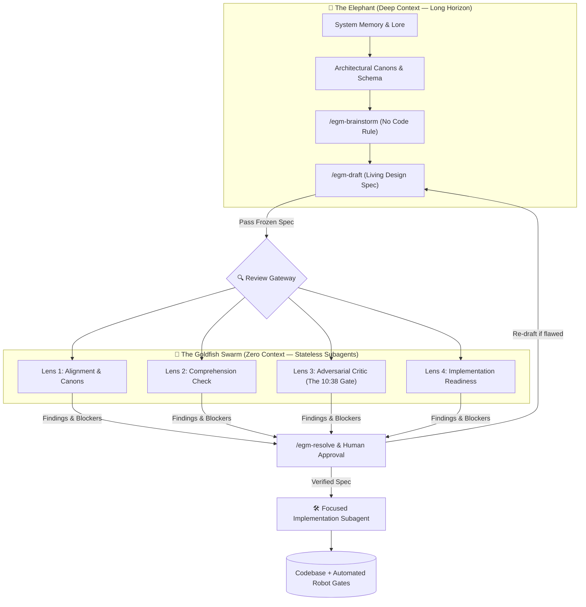
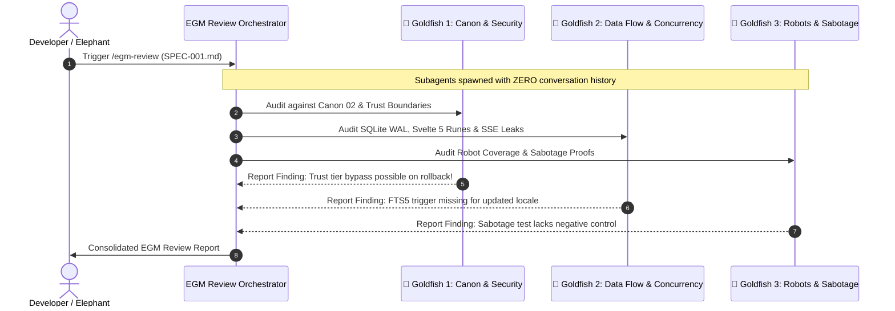

# 01 · EGM (Elephant-Goldfish Model) in Przymierze Lemiesza: Architectural Guide & Operational Playbook

> **Doc type:** PRACTICAL GUIDE & OPERATIONAL PLAYBOOK  
> **Target Audience:** Core Developers, System Architects, and Autonomous AI Agents (Antigravity, Claude Code)  
> **Canon Reference:** [Canon 02 · Architecture Manifesto](../00_Canon/02_Architecture_Manifesto.md) | [Canon 03 · Rules of Engagement](../00_Canon/03_Rules_of_Engagement.md)  
> **Source Video:** [EGM: Google's New Way To Use Claude Code Is Insane (`xxf6D9jynFw` @ 10:38)](https://www.youtube.com/watch?v=xxf6D9jynFw&t=638s)  
> **Upstream Repository:** [`google/elephant-goldfish-model`](https://github.com/google/elephant-goldfish-model) (Dave Rensin / Google)

---

## Executive Summary: Why EGM Matters for `lemiesz`

In generative AI development, the most common trap is **premature implementation**: prompting an LLM to immediately generate code. In a small demo, this feels fast; in an ideological knowledge base like **Przymierze Lemiesza (`lemiesz`)**, it is disastrous. As context windows grow, agents suffer from **context rot**, **confirmation bias**, and **"yes-man" compliance**—eagerly writing fragile code that hallucinates citations, bypasses human approval gates, or violates SQLite concurrency constraints.

The **Elephant-Goldfish Model (EGM)**, pioneered at Google and open-sourced for agent harnesses (Antigravity, Claude Code, Codex), replaces vibe-coding with **Spec-Driven Development (SDD)** by enforcing a cognitive separation between two agent personas:



1. **The Elephant (Deep Context / Long Memory):** Holds the repository's entire canon, database schemas, and ideological constraints. **The Elephant writes zero application code.** Its sole duty is exploring problem spaces, conducting trade-off debates, and compiling rigorous, living specifications in Markdown.
2. **The Goldfish (Zero Context / Stateless Reviewers):** Isolated subagents spawned with a completely clean slate—no chat history, no conversational bias, no access to brainstorming rationalizations. Equipped only with the draft spec and the existing codebase, the Goldfish swarm relentlessly stress-tests the design.
3. **The 10:38 Breakthrough ([Video timestamp 10:38](https://www.youtube.com/watch?v=xxf6D9jynFw&t=638s)):** At minute 10:38, the video reveals how a zero-context Goldfish caught a fatal design flaw in live production that both human engineers and the context-heavy Elephant missed. The Goldfish demonstrated the foundational law of EGM:
   > *"The Goldfish does not know what you intended—only what you wrote. If a stateless agent cannot implement the feature cleanly from the spec alone, the spec is broken, not the builder."*

In `lemiesz`, where credibility is existential and truthfulness of citations is non-negotiable, EGM is not merely an optional workflow—it is our primary defense against hallucination cascades and architectural decay.

---

## 1. Anatomy of the Two Cognitive Roles

| Dimension | 🐘 The Elephant | 🐠 The Goldfish |
| :--- | :--- | :--- |
| **Context Window** | Massive / Full project history & canons | Zero / Fresh ephemeral subagent session |
| **Cognitive Bias** | High ("Curse of Knowledge", sunk cost, self-justification) | Zero (Objective, agnostic, completely uninfluenced) |
| **Primary Output** | Markdown Specs (`docs/03_EGM/designs/*.md`) | Antagonistic Critiques & Finding Reports |
| **Allowed to Code?** | ❌ **Strictly Forbidden** | ❌ **Strictly Forbidden** (Reviews only) |
| **Verification Lens** | "Does this fulfill the vision of Przymierze Lemiesza?" | "Can this fail? Can this break? Are there blind spots?" |
| **Execution Tool** | Antigravity Orchestrator / Claude Code Master Session | `invoke_subagent` / Ephemeral Claude Code subagents |

---

## 2. The Video Revelation: What Happens at `t=638s` (10:38)

In the tutorial breakdown ([YouTube: `xxf6D9jynFw` @ 10:38](https://www.youtube.com/watch?v=xxf6D9jynFw&t=638s)), the narrator presents the pivotal moment that proves why the Elephant-Goldfish Model is a paradigm shift:

### The "Curse of Knowledge" Trap
During drafting, the human engineer and the long-lived Elephant had spent 45 minutes discussing how authentication tokens, state caches, and background polling should interact. In their minds, the mechanism was obvious because the context was shared across dozens of turns.

### The Goldfish Shootdown (10:38)
When `/egm-review` was triggered, an isolated Goldfish subagent was spun up with *zero prior turns*. Reading only the generated Markdown spec, the Goldfish immediately flagged:
1. **Unstated Precondition:** A cache-invalidation race condition where background tasks could write stale data to local storage without checking token expiration.
2. **Missing Rollback Matrix:** No definition of what happens when the network drops mid-transaction.
3. **Implicit Dependency:** The spec assumed a database helper was global when it was scoped to an isolated module.

The human and the Elephant had failed to notice this because *their conversation context bridged the gap*. The Goldfish, possessing only the literal text of the document, exposed the hole in seconds.

### The Core Lesson for `lemiesz`
When developing for `lemiesz` (e.g. Ideological Shield, Review Queue, or Content Engine), **an implementation prompt must never be given to an agent until a zero-context Goldfish has failed to break the specification**.

---

## 3. Mapping EGM to Przymierze Lemiesza Architecture

The `lemiesz` project operates under strict canonical rules. EGM maps directly onto these invariants:

```
+-----------------------------------------------------------------------------------+
|                           PRZYMIERZE LEMIESZA CANON                               |
+-----------------------------------------------------------------------------------+
|  Canon 02: Truthful Citations | Human Authority | Zero External DB | Simplicity   |
|  Canon 03: "Conclusions Rot; Robots Don't" | "One Fact, One Home" | Sabotage Rule |
+-----------------------------------------+-----------------------------------------+
                                          |
                                          v
+-----------------------------------------------------------------------------------+
|                        EGM SPEC-DRIVEN DEVELOPMENT (SDD)                          |
+-----------------------------------------------------------------------------------+
|  1. /egm-brainstorm  --> No-code ideological boundary exploration                 |
|  2. /egm-draft       --> Living specification in docs/03_EGM/designs/             |
|  3. /egm-review      --> 4-Lens Goldfish verification against Canon & Robots      |
|  4. /egm-resolve     --> Human decision gate (only human approves spec changes)   |
|  5. Implementation   --> Clean builder subagent writes code strictly from spec    |
|  6. Automated Robots --> Robot Fleet (ROBOT-01 to ROBOT-10) enforces invariants   |
+-----------------------------------------------------------------------------------+
```

### Direct Alignment with `lemiesz` Invariants:

1. **Truthful Citations ([ROBOT-01](../17_Robots/ROBOT-01-verbatim-quotation-gate.md)):**
   - *EGM Rule:* Any spec proposing an LLM generation feature (such as the Shield or Content Engine) must explicitly detail the deterministic token expansion mechanism (`[[src:ID]]` / `[[quote:ID]]`) and the substring assertion gate.
2. **Human Authority Write Boundary ([ROBOT-02](../17_Robots/ROBOT-02-trust-tier-write-boundary.md)):**
   - *EGM Rule:* The spec must never permit an automated pipeline to grant `human_approved` status. The Goldfish review checks every proposed schema transition.
3. **One Fact, One Home (Canon 03, D2):**
   - *EGM Rule:* The spec must not restate facts owned elsewhere (e.g., test statuses belong in `10_Harness/02_Harness_Ledger.md`, doctrine belongs in `corpus/canon/`). The Goldfish verifies that the spec links to authoritative sources rather than duplicating them.
4. **The Three Homes of Every Robot (Canon 03, D3):**
   - *EGM Rule:* If a feature introduces a new architectural invariant, the spec must allocate its three homes:
     - Spec file: `docs/17_Robots/ROBOT-XX-<name>.md`
     - Ledger entry: `docs/10_Harness/02_Harness_Ledger.md`
     - Test suite: `scripts/robots/` or `tests/robots/`
5. **The Sabotage Rule (Canon 03, D4):**
   - *EGM Rule:* The Goldfish verifies that the spec defines a negative control / sabotage test to prove the gate turns RED when violated.

---

## 4. End-to-End EGM Workflow: Step-by-Step Tutorial

### Directory Layout for EGM Artifacts
All EGM specifications in `lemiesz` are housed under `docs/03_EGM/`:

```text
docs/03_EGM/
├── 01_EGM_Elephant_Goldfish_Model_Guide.md  <-- This master guide
├── designs/                                  <-- Living design specifications
│   ├── SPEC-001_cultural_media_engine.md
│   └── SPEC-002_vector_recalibration.md
└── reviews/                                  <-- Recorded Goldfish reviews & findings
    ├── 2026-10-26_REVIEW_SPEC-001.md
    └── 2026-10-26_REVIEW_SPEC-002.md
```

---

### Step 1: `/egm-brainstorm` (Elephant Session — No Code Allowed)

**Objective:** Explore the problem space, debate trade-offs, and define scope without touching code.

**How to run in Antigravity or Claude Code:**
```text
/egm-brainstorm "Add cross-lingual quote verification for English translations of Polish historical sources"
```

**What the Elephant does:**
- Examines `src/lib/` and existing database tables (`sources`, `arguments`, `eval/golden.json`).
- Asks clarifying questions:
  - *What tokenizer should be used for cross-lingual alignment?*
  - *Will this require an extra SQLite migration or virtual table?*
  - *How does this impact the offline ONNX embedder memory footprint?*
- Produces a concise **Concept Brief** outlining:
  - Goal & Non-Goals.
  - Architectural constraints.
  - Candidate options.

---

### Step 2: `/egm-draft` (Elephant Session — Compiling the Specification)

**Objective:** Translate the concept brief into an exhaustive Markdown specification.

**How to run:**
```text
/egm-draft docs/03_EGM/designs/SPEC-001_feature_name.md
```

**Mandatory Specification Sections for `lemiesz`:**
1. **Metadata & Status:** ID, Title, Author, Date, Target Module.
2. **Canon Compliance Check:** How does this comply with Canon 02 (Trust tiers, SQLite WAL, Offline-first)?
3. **Data Model Changes:** Exact SQLite DDL statements (if migrations needed).
4. **Data Flow & Sequence:** Mermaid sequence diagram illustrating SSE or request flow.
5. **Token & Citation Handling:** Exact tokens emitted (`[[src:ID]]`) and expansion mechanics.
6. **Robots & Sabotage Plan:** How will this be tested? What is the failure proof?
7. **Files Affected:** Complete explicit paths of every file to be created or edited.

---

### Step 3: `/egm-review` (The Goldfish Swarm — Zero-Context Audit)

**Objective:** Unleash stateless Goldfish subagents to violently critique the specification before any implementation begins.

In **Antigravity**, this is executed by launching subagents using `invoke_subagent` with isolated prompts:



#### The 4 Verification Lenses:
1. **Lens 1: Zoom Out & Canon Verification**
   - Does this add external SaaS dependencies? (Violates Canon 02, Item 3).
   - Does this permit an automated path to `human_approved`? (Violates ROBOT-02).
2. **Lens 2: Comprehension Check**
   - The Goldfish is asked: *"Summarize the state transition of a rejected draft in your own words."* If the subagent misinterprets the text, the spec is ambiguous and must be clarified.
3. **Lens 3: The Adversarial Critic (The 10:38 Check)**
   - Can an attacker send a poisoned SSE payload?
   - What happens if the SQLite WAL file is locked by a backup drill?
   - Is there a race condition between the Svelte 5 rune `$effect` and form submission?
4. **Lens 4: Implementation Readiness & Robot Gate Proof**
   - Can a junior developer or a stateless coding agent implement this feature without asking questions?
   - Is there an automated Robot that will turn RED if this breaks?

---

### Step 4: `/egm-resolve` (Triage & Human Authority)

All findings from the Goldfish review are documented in `docs/03_EGM/reviews/` and triaged:

- **BLOCKER:** Architectural violation, security risk, citation hallucination loophole. (Must be fixed in the spec before coding).
- **CONCERN:** Edge case missing, documentation ambiguity. (Spec updated).
- **NIT:** Formatting or naming preference.

> **CRITICAL RULE:** In accordance with [Canon 02](../00_Canon/02_Architecture_Manifesto.md), only a human engineer may approve the final specification resolution. The AI never approves its own plan.

---

### Step 5: Implementation Handoff (The Builder Subagent)

Once the specification passes the Goldfish review and receives human sign-off, implementation begins:

1. A dedicated, focused coding subagent (or session) is invoked.
2. The agent is provided **only** the approved `SPEC-001.md` and repository guidelines.
3. The agent implements the changes file by file.
4. Because the spec was audited for zero ambiguity, code generation succeeds on the first attempt without prompt churning or debugging loops.

---

### Step 6: Verification & Robot Execution

After coding, the implementation is verified against the project's test suite:

```bash
# 1. Type & Rune Check
pnpm check

# 2. Unit & Integration Tests (offline throw-away DB)
pnpm test

# 3. Robot Fleet Invariant Gate
pnpm vitest run --config vitest.robots.config.ts

# 4. Golden Set Recall & Verbatim Citation Gate
pnpm eval
```

---

## 5. EGM Specification Template for `lemiesz`

Save new specifications in `docs/03_EGM/designs/SPEC-XXX_<short_name>.md` using this template:

```markdown
# SPEC-XXX: [Title of Feature or Change]

| Metadata | Details |
| :--- | :--- |
| **Status** | 📝 DRAFT / 🔍 UNDER GOLDFISH REVIEW / ✅ APPROVED / 🚀 IMPLEMENTED |
| **Author** | [Author / Elephant Session] |
| **Date** | YYYY-MM-DD |
| **Owner Module** | [e.g. Shield / Repository / Content Engine / Robots] |
| **Related Robots** | [e.g. ROBOT-01, ROBOT-02, ROBOT-06] |

---

## 1. Context & Motivation
[Describe the problem. Why is this necessary? Link to existing canons or issues.]

## 2. Invariants & Canon Compliance
- [ ] **Canon 02 (Trust Tiers):** Does this respect human approval boundaries?
- [ ] **Canon 02 (Citations):** Are citations verbatim and sourced from SQLite rows?
- [ ] **Canon 02 (Sovereignty):** Does this avoid external SaaS/cloud DB requirements?
- [ ] **Canon 03 (One Fact, One Home):** Are facts linked rather than duplicated?

## 3. Data Architecture & Migrations
[Include exact SQLite schema changes or state if zero migrations are needed.]

## 4. Component Flow & Architecture
[Include Mermaid diagram for SSE, Runes state, or API flow.]

## 5. Affected Files & Concrete Edits
- `src/lib/...`: [Detailed description of function/rune to add/edit]
- `tests/...`: [Test cases to add]
- `docs/...`: [Documentation to update]

## 6. The Three Homes of New Verification (Robots)
1. **Spec Home:** `docs/17_Robots/ROBOT-XX-...md`
2. **Ledger Home:** `docs/10_Harness/02_Harness_Ledger.md`
3. **Execution Home:** `tests/robots/robot-XX-...test.ts`
- **Proof of Failure (Sabotage Test):** [Explain how this gate is proven to turn RED]

## 7. Goldfish Review Log & Triage
- [ ] Review Lens 1 (Canon & Security): Passed / Issues: ...
- [ ] Review Lens 2 (Comprehension): Passed / Issues: ...
- [ ] Review Lens 3 (Adversarial Critic - 10:38): Passed / Issues: ...
- [ ] Review Lens 4 (Implementation Readiness): Passed / Issues: ...
```

---

## 6. Practical Tooling Guide: Antigravity & Claude Code Setup

### Option A: Using EGM in Google Antigravity

Antigravity natively supports the subagent architecture needed for EGM:
1. **Elephant Mode:** Use your main conversation session for brainstorming and drafting. Give it full access to read files and explore the repository.
2. **Goldfish Mode:** Use the `invoke_subagent` tool with `TypeName: "research"` or `"self"` and explicitly restrict context in the prompt:
   ```json
   {
     "TypeName": "research",
     "Role": "Zero-Context Goldfish Auditor",
     "Prompt": "You are a Goldfish auditor in the Elephant-Goldfish Model (EGM). You have ZERO context about how this feature was conceived. Read ONLY 'docs/03_EGM/designs/SPEC-XXX.md' and the target source code. Your job is to tear this specification apart. Look for edge cases, citation leakage, SQLite locking pitfalls, and trust boundary bypasses. Produce a findings table categorized by BLOCKER, CONCERN, and NIT."
   }
   ```

### Option B: Using EGM in Claude Code

In Claude Code, install the official Google EGM plugin from the marketplace:
```bash
# Add the EGM plugin to Claude Code
claude plugin marketplace add google/elephant-goldfish-model
claude plugin install egm@egm
```

Once installed, use the slash commands natively:
- `/egm:egm-brainstorm` — Explore problem boundaries without code.
- `/egm:egm-draft` — Compile the markdown specification.
- `/egm:egm-review` — Spawn zero-context subagents to run the review swarm.
- `/egm:egm-resolve` — Triage feedback with human-in-the-loop signoff.
- `/egm:egm-drift-report` — Periodically detect divergence between code and design specs.

---

## 7. Summary Checklist: The EGM Commandments in `lemiesz`

| Commandment | Rationale |
| :--- | :--- |
| **1. Never let the Elephant code.** | An agent that drafts the plan must not rush to code it; it will hide its own mistakes. |
| **2. Review with zero context.** | Reviewers who know the backstory forgive ambiguities. Goldfish show no mercy. |
| **3. Remember 10:38.** | The bug caught at 10:38 proves that unwritten assumptions always fail in production. |
| **4. Human holds the keys.** | Only authenticated humans can approve specifications and public-facing texts. |
| **5. Proof of Failure is mandatory.** | A test or spec you haven't seen fail cannot be trusted. Always verify the sabotage case. |
| **6. One fact, one home.** | Never duplicate architectural claims. Link directly to the authoritative ledger. |

---

*Document registered under `docs/03_EGM/01_EGM_Elephant_Goldfish_Model_Guide.md`.*  
*Przymierze Lemiesza Architecture Governance.*
