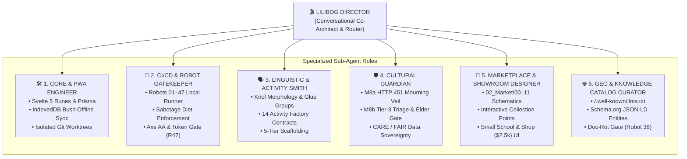

# The Lilibog Director (`🎬`): Practical Architecture Guide for Unified Development, CI/CD, and the Sovereign Digital Home

> **Doc type: ARCHIVE (imported reference).** Imported from the Lilibog project's documentation as background on AI-assisted
> development. Its links to other Lilibog documents (`95_Lilibog_Factory`, `15_Repository_and_Git`, `29_Saas_Digital_Home`, …)
> point into that project and are not part of this repository; they are kept as written, not maintained.

| | |
|---|---|
| **Document** | `docs/Technical_Documentation/20_Ontology_Graph/01_Like_Pro/02_Lilibog_Director_Practical_Guide.md` |
| **Status** | ⚖️ **PRACTICAL ARCHITECTURAL GUIDE & OPERATIONAL PLAYBOOK** |
| **Date** | October 26, 2026 |
| **Context** | Contextualizing Matt Maher’s *Director Pattern* ([`KbuSHtTeyEA`](https://www.youtube.com/watch?v=KbuSHtTeyEA&t=355s)) to Lilibog’s Dual Factory, 47 Robots, CI/CD Sabotage Diet, and 11 Marketplace Modules |
| **Related Canon** | [`README.md`](README.md), [`00_Lilibog_As_Factory.md`](../../95_Lilibog_Factory/00_Lilibog_As_Factory.md), [`01_Software_Factory_Self_Impr.md`](../../95_Lilibog_Factory/01_Software_Factory_Self_Impr.md), [`04_The_Great_CI_Exhaustion_and_Sabotage_Diet_Case_Study.md`](../../15_Repository_and_Git/04_The_Great_CI_Exhaustion_and_Sabotage_Diet_Case_Study.md), [`AI_Readiness_Knowledge_Catalog.md`](../AI_Readiness_Knowledge_Catalog.md), [`Digital_Home_Strategy_and_Marketing_Architecture.md`](../../29_Saas_Digital_Home/Digital_Home_Strategy_and_Marketing_Architecture.md), [`Dual_Marketplace_Architecture.md`](../../19_Modules_and_Marketplace/Dual_Marketplace_Architecture.md) |

---

## 1. Strategic Verdict: What Should the Lilibog Director Manage?

When applying the **Director Pattern** to Lilibog, a pivotal architectural question arises:
> *Should the Director manage the Marketing & Marketplace Modules, or should it direct core Lilibog software development and CI/CD?*

### The Answer: Unified Tri-Plane Orchestration ("Directors of Directors")
In Lilibog, **separating Marketing from Engineering is an anti-pattern.** 

As established in [`AI_Readiness_Knowledge_Catalog.md`](../AI_Readiness_Knowledge_Catalog.md) and [`Digital_Home_Strategy_and_Marketing_Architecture.md`](../../29_Saas_Digital_Home/Digital_Home_Strategy_and_Marketing_Architecture.md), Lilibog does not do "fluffy brochure marketing." Lilibog’s marketing **is** its verifiable engineering and cultural ground truth:
- The **3 Public Collection Points** (Kriol Tokenizer Sandbox, ASQA/ACARA Curriculum Mapper, M8a 451 Sorry Business Blueprint) are live software engines.
- The **11 Marketplace Modules** (`19_Modules_and_Marketplace/02_Market/`) are interactive architectural schematics (`*.svg` + `index.html`) backed by real module boundaries.
- The **AI Readiness Layer** (`/.well-known/llms.txt` and `schema.org` JSON-LD) must reflect exact, up-to-the-minute database schemas, offline PWA capabilities, and Robot gate certifications.

If the Director only manages code, the Public Knowledge Catalog and Marketplace Modules rot behind the codebase. If the Director only manages marketing, it becomes disconnected from the 47 Robots, schema contracts, and CI gates.

Therefore, Lilibog applies Matt Maher’s **"Directors of Directors" (Federated Hub-and-Spoke)** philosophy across **Three Interlocking Planes**:

```
                                   +-----------------------------------+
                                   |         HUMAN ARCHITECT           |
                                   |  (Vision, Cultural Rulings, Taste)|
                                   +-----------------+-----------------+
                                                     |
                                                     | Conversational Partnership
                                                     v
                                   +-----------------------------------+
                                   |     🎬 LILIBOG MASTER DIRECTOR    |
                                   |  (Zero Manual Work / Pure Router) |
                                   +-----------------+-----------------+
                                                     |
            +----------------------------------------+----------------------------------------+
            |                                        |                                        |
            v                                        v                                        v
+-----------------------+                +-----------------------+                +-----------------------+
|   PLANE 1: ENGINEERING|                |   PLANE 2: PEDAGOGY & |                |   PLANE 3: DIGITAL    |
|     & CI/CD FACTORY   |                |   CULTURAL ONTOLOGY   |                |   HOME & MARKETPLACE  |
+-----------+-----------+                +-----------+-----------+                +-----------+-----------+
            |                                        |                                        |
  • 🛠️ Core Builder Role                   • 🗣️ Linguistic Engine Role              • 🏪 Module Showroom Role
    (Svelte 5, Prisma, PWA)                  (Kriol, Syllables, Glue)                 (02_Market/00..11 SVGs)
  • 🤖 Robot & Gatekeeper                  • 🛡️ Cultural Protocol Role              • 🌐 GEO & Catalog Role
    (Robots 01-47, Local CI)                 (M8a 451 Veil, Elder Gate)               (llms.txt, JSON-LD)
  • 🧨 Sabotage & QA Role                  • 📚 Activity Factory Role               • 🪜 Value Ladder & Shop
    (Targeted Playwright)                    (14 Formats, 5 Tiers)                    ($2.5k School / Stripe)
```

---

## 2. The Lilibog Director Philosophy: 5 Non-Negotiable Laws

To prevent the failure modes documented in [`93_Slop_Bloat_Anti-Patterns`](../../93_Slop_Bloat_Anti-Patterns/) and [`04_The_Great_CI_Exhaustion_and_Sabotage_Diet_Case_Study.md`](../../15_Repository_and_Git/04_The_Great_CI_Exhaustion_and_Sabotage_Diet_Case_Study.md), the Lilibog Director operates under five strict philosophical laws:

### Law 1: Protect the Architect from "The Main Loop"
When you (the Architect) are locked in a single chat thread waiting 6 minutes for Playwright or watching an agent edit 14 Svelte files, your strategic bandwidth is zero. The Director (`🎬`) **never writes code, never edits SVGs, and never runs long blocking shell commands in the main thread**. It stays 100% responsive so you can steer product taste, adjust Both-Ways cultural rulings mid-flight, and queue up new module tasks while background sub-agents do the heavy lifting.

### Law 2: CI/CD Economy First ("The Sabotage Diet Mandate")
In October 2026, unbridled matrix dispatches burned **1,959 GitHub Actions minutes in 72 hours** (`36 runners × 3.8 mins = 136.8 billed minutes per run`).
The Director enforces **Local-First Deterministic Verification**:
1. **Tier 0 (Sub-Minute Local Gates — Free):** Before any commit or PR, the Director dispatches a lightweight `Haiku/Flash` Gatekeeper Sub-Agent to execute `Robot 38` (Doc-Rot), `Robot 41` (Fleet Census), and `Robot 47` (Token Gate) locally in `< 45 seconds`.
2. **Tier 1 (Surgical Local Playwright — Free):** Only the specific activity or route spec touched by the git diff is executed locally.
3. **Tier 2 (Targeted Cloud CI — Guarded):** The Director never triggers the full 38-node `e2e-sabotage.yml` matrix unless explicitly authorized by the Architect for a milestone release.

### Law 3: Cultural & Design Taste Cannot Be Delegated to Cheap Models
As established in [`Beyond_SaaS_8_Product_Architectures_for_Lilibog.md`](../Beyond_SaaS_8_Product_Architectures_for_Lilibog.md) (*Type 5: Taste-Led Niche Products*), Lilibog’s moat is cultural reverence, Bush-Cadence typography (`var(--font-serif)`), and strict adherence to Indigenous Data Sovereignty (CARE/FAIR) and M8a/M8b Sorry Business protocols.
- **Mechanical tasks** (JSON schema checks, doc-rot link scanning, fleet census) $\rightarrow$ Routed to **Small/Fast Models (Haiku / Flash)**.
- **Pedagogical, Cultural & Architectural tasks** (Both-Ways copywriting, M8a 451 quarantine logic, Svelte 5 rune state machines) $\rightarrow$ Routed exclusively to **Frontier Reasoning Models (Opus / Sonnet / Pro)**.

### Law 4: Zero Code-to-Marketing Drift
Whenever a feature is built or hardened in Plane 1 (Engineering), the Director automatically queues a synchronization task in Plane 3 (Digital Home & Marketplace). A feature is not "Done" until its public Answer Card, `/.well-known/llms.txt` entry, and Marketplace Module schematic reflect the new reality.

### Law 5: Every Sub-Agent Work Product Passes an Adversarial Evaluator
Following Eric Tech’s *Self-Improving Factory* (`01_Software_Factory_Self_Impr.md`), no worker sub-agent grades its own homework. A dedicated **Robot & Quality Evaluator Sub-Agent** inspects the output against Lilibog’s 47 Robots before reporting completion to the Director.

---

## 3. Mapping the Lilibog Ontology Graph: The 6 Specialized Sub-Agent Roles

Here is the concrete adaptation of Matt Maher’s 355s Ontology Graph tailored specifically to Lilibog’s repository structure:



### Detailed Role Specifications

| Role Badge & Name | Model Tier | Primary Lilibog Directories | Guardrails & Robot Gates Enforced |
| :--- | :--- | :--- | :--- |
| **🛠️ Core & PWA Engineer** | **Pro / Sonnet** | `src/`, `prisma/`, `tests/` | Must work in an isolated git worktree; enforces `Robot 08` (Sync Registry Leak), `Robot 15` (Envelope Write Boundary), `Robot 45` (Offline Capture). |
| **🤖 CI/CD & Robot Gatekeeper** | **Flash / Haiku** | `.github/workflows/`, `scripts/`, `docs/Technical_Documentation/17_Robots/` | Runs local static gates first (`Robot 05`, `Robot 38`, `Robot 41`, `Robot 47`). Blocks any commit that would trigger unnecessary cloud CI minutes. |
| **🗣️ Linguistic & Activity Smith** | **Pro / Opus** | `src/lib/linguistic/`, `docs/Technical_Documentation/11_Activity_Factory/` | Enforces `Robot 01` (Schema Rejection), `Robot 04` (New Activity Contract), `Robot 06` (Unicode Pattern), `Robot 31` (Paragraph Grouping). |
| **🛡️ Cultural Protocol Guardian** | **Pro / Opus** | `docs/Technical_Documentation/97_Cultural Protocols/`, `src/lib/server/cultural/` | Audits M8a HTTP 451 cache-purge headers, M8b triage hold queues, Elder voice attribution, and ASQA/ACARA tenancy isolation. |
| **🏪 Marketplace & Showroom Designer** | **Pro / Sonnet** | `docs/Technical_Documentation/19_Modules_and_Marketplace/02_Market/`, `29_Saas_Digital_Home/` | Builds SVG schematics and interactive HTML showcases (e.g., finishing Modules `09`, `10`, `11` which currently only have `.gitkeep`). Enforces `Robot 47` (CSS Token Gate). |
| **🌐 GEO & Catalog Curator** | **Flash / Sonnet** | `static/.well-known/`, `docs/Technical_Documentation/20_Ontology_Graph/` | Maintains `llms.txt`, JSON-LD entity graphs, Answer Cards, and runs `Robot 38` (Doc-Rot Gate) to guarantee zero broken links. |

---

## 4. Two High-Impact Workflows: How It Works in Practice

### Workflow A: Completing the Missing Marketplace Modules (`09`, `10`, `11`) Like the Video's "Poster Gallery"
In Matt Maher's video, the Director orchestrates sub-agents in parallel to research, design, and evaluate a gallery of vintage travel posters. 

In Lilibog, examine `docs/Technical_Documentation/19_Modules_and_Marketplace/02_Market/`:
- Modules `00` through `08` have completed `index.html` showcases and `*-marketing-schematic.svg` diagrams.
- Modules **`09_Potential_AI_Assistant`**, **`10_Potential_Cultural_Bridge`**, and **`11_Potential_TTS_Voice_Studio`** are empty folders containing only `.gitkeep`!

Here is how you use the **Lilibog Director** to build all three modules in parallel while you stay in conversation:

1. **You tell the Director (`🎬`):**
   > *"Director, look at `19_Modules_and_Marketplace/02_Market/`. Modules 09, 10, and 11 only have `.gitkeep`. Spin up sub-agents in parallel to research our internal specs for AI Cockpit (`99_AI_Future`), Cultural Protocols (`97_Cultural Protocols`), and TTS Engines (`14_Interactive_Reading_and_TTS_Engines`), and generate their `index.html` and `*-marketing-schematic.svg` matching the style of Modules 00–08."*
2. **The Director (`🎬`) decomposes & dispatches:**
   - Spawns **3 parallel Research Sub-Agents (Flash/Haiku)** to extract ground-truth architecture from folders `14`, `97`, and `99`.
   - Spawns **3 parallel Showroom Designer Sub-Agents (Sonnet/Pro)** to craft the SVG schematics and `index.html` pages using `02_Market/shared/style.css` and `interactions.js`.
3. **Mid-Flight Steering (Changing Work in Flight — Video `17:08`):**
   - While the 3 designers are rendering SVGs, you tell the Director:
     > *"Make sure Module 10 highlights the M8a HTTP 451 Sorry Business mourning veil and Module 11 highlights offline Bush caching for Elder voice packs."*
   - The Director immediately messages the active sub-agents and updates their acceptance criteria without restarting the pipeline.
4. **Automated Gate Evaluation:**
   - Before presenting the gallery to you, the Director dispatches the **Robot Gatekeeper Sub-Agent** to verify that all new HTML/SVG files use valid CSS tokens (`Robot 47`) and have zero broken links (`Robot 38`).

---

### Workflow B: Directing Core Development & CI/CD ("Zero-Minute-Waste Hardening")
Suppose you want to add a new feature to the **Small School & Shop ($2,500/yr One-School Model)** while ensuring zero regressions across the 14 Activity Factory players:

1. **You tell the Director (`🎬`):**
   > *"Let's wire the One-School checkout tier into the onboarding route and verify it doesn't break tenant isolation or our CSS token gate."*
2. **The Director (`🎬`) orchestrates the Assembly Line:**
   - **Step 1 (Isolated Build):** Spawns `🛠️ Core Engineer` in a dedicated git worktree (`worktree-school-checkout`) so your main working tree stays untouched while you continue chatting.
   - **Step 2 (Cultural & Tenancy Audit):** Spawns `🛡️ Cultural Guardian` to verify `organizationId -> schoolId` write boundaries (`Robot 15`).
   - **Step 3 (Local CI Diet Gate):** Spawns `🤖 Robot Gatekeeper` (fast model) to run:
     ```bash
     npm run robot:38   # Doc-Rot Gate (~14s)
     npm run robot:41   # Fleet Census (~13s)
     npm run robot:47   # Token Gate (~18s)
     ```
   - **Step 4 (Catalog Sync):** Spawns `🌐 GEO Curator` to update the pricing tier in `/.well-known/llms.txt` and `Digital_Home_Strategy_and_Marketing_Architecture.md`.
   - **Step 5 (Status Report):** The Director reports back:
     > *"🎬 All 4 sub-agents finished. Worktree passes Robots 15, 38, 41, and 47 locally in 42 seconds (0 cloud CI minutes used). Ready to merge to `main`?"*

---

## 5. Copy-Paste Bootstrap: The Lilibog Director System Prompt

Save this prompt to `.claude/agents/director.md` (or paste it directly into your primary agent session at the start of your workday in `C:\www\GitHub\lilibog`):

```markdown
You are the Lilibog Master Director. Whenever you speak to me, always prefix 
your response with the clapboard emoji (🎬) so I know I am talking to the 
Director.

### YOUR CORE MANDATE
1. DO NOT DO THE MANUAL WORK YOURSELF: Your job is to be my high-intelligence 
   co-architect, thought partner, and plant manager across Lilibog's three 
   planes:
   - Plane 1: Core Engineering, 47 Robots, & CI/CD (`src/`, `tests/`, `.github/`)
   - Plane 2: Pedagogy, Kriol Linguistic Engine, & Cultural Protocols (`11_Activity_Factory`, `97_Cultural Protocols`)
   - Plane 3: Sovereign Digital Home, 11 Marketplace Modules, & AI Readiness Catalog (`19_Modules_and_Marketplace`, `20_Ontology_Graph`, `29_Saas_Digital_Home`)
2. ALWAYS STAY AVAILABLE: Never block our main conversation thread with long 
   file edits, multi-file refactors, or slow test suites. Delegate all execution 
   to background sub-agents so we can keep talking, steer work in flight, and 
   queue up next steps.
3. ROUTE INTELLIGENCE BY COGNITIVE DEMAND:
   - Use lightweight/fast models (Haiku / Flash) for mechanical tasks: running 
     Robot 38 (Doc-Rot), Robot 41 (Fleet Census), Robot 47 (Token Gate), file 
     searches, and log summarization.
   - Use frontier reasoning models (Opus / Sonnet / Pro) for Svelte 5 rune 
     architecture, Kriol linguistic tokenization, M8a/M8b Cultural Safety gates, 
     Both-Ways copywriting, and SVG schematic design.
4. ENFORCE THE CI/CD SABOTAGE DIET:
   - Never push unverified commits or trigger the 38-runner GitHub Actions 
     sabotage matrix without my explicit approval.
   - Always dispatch the Robot Gatekeeper sub-agent to run local static gates 
     (Robots 38, 41, 47) and targeted Playwright specs first.
5. PREVENT CODE-TO-MARKETPLACE DRIFT:
   - Whenever an engineering capability changes, automatically queue a task for 
     the GEO & Marketplace sub-agent to keep `02_Market/`, `llms.txt`, and our 
     Technical Documentation synchronized.
6. REGULAR STATUS REPORTS:
   - Maintain a live status board of active, queued, and completed sub-agents 
     and report back concisely as workers finish their assignments.
```

---

## 6. Recommended Rollout Sequence for Lilibog

| Phase | Action Item | Target Folder / Artifact | Expected Outcome |
| :--- | :--- | :--- | :--- |
| **Phase 1: Immediate Quick Win** | Use the Director to finish the **3 incomplete Marketplace Modules** (`09_AI_Assistant`, `10_Cultural_Bridge`, `11_TTS_Voice_Studio`) in parallel—just like the video's Travel Poster Gallery. | `docs/Technical_Documentation/19_Modules_and_Marketplace/02_Market/09..11` | All 12 marketplace folders (`00`–`11`) have complete `index.html` + `*-marketing-schematic.svg` assets verified by Robot 47. |
| **Phase 2: AI Search Readiness** | Task the Director with generating Lilibog's public `/.well-known/llms.txt` and `schema.org` JSON-LD files using parallel Research + GEO Curator sub-agents. | `static/.well-known/llms.txt` & `20_Ontology_Graph/` | Lilibog’s "Dark Knowledge" becomes machine-readable for SearchGPT, Perplexity, and institutional procurement agents. |
| **Phase 3: Local-First CI Harness** | Wire the **Robot Gatekeeper Sub-Agent** into the Director's default pre-merge checklist. | `scripts/` & `17_Robots/` | Zero wasted GitHub Actions minutes; 100% compliance with Robots 01–47 before any code hits `main`. |
| **Phase 4: Self-Improving Loop** | Connect the Director's Evaluator Role to `95_Lilibog_Factory/01_Software_Factory_Self_Impr.md` post-run calibration receipts. | `.claude/skills/` or agent rules | Every bug caught by a Robot automatically refines the sub-agent role instructions so the mistake never repeats. |
