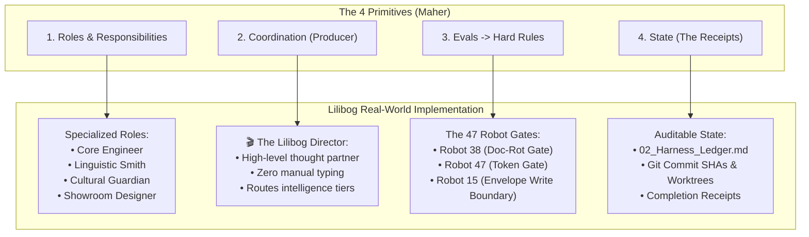

# AI Agent Teams Explained: The Four Primitives of Agentic Systems

> **Doc type: ARCHIVE (imported reference).** Imported from the Lilibog project's documentation as background on AI-assisted
> development. Its links to other Lilibog documents (`95_Lilibog_Factory`, `15_Repository_and_Git`, `29_Saas_Digital_Home`, …)
> point into that project and are not part of this repository; they are kept as written, not maintained.

> **Reference Material:** Based on the masterclass by Matt Maher:  
> 🔗 [Watch on YouTube: "Work Like the Pros: AI Agent Teams, Explained" (ID: 79hKmlnyvso)](https://www.youtube.com/watch?v=79hKmlnyvso)  
> **Companion Document:** [`README.md`](README.md) (The Director Pattern & Agentic Ontology Graph)

---

## Executive Summary: Beyond the "Single Chat" Bottleneck

Most people interact with Artificial Intelligence through a single prompt window. While effective for simple questions, treating AI as a lone conversational assistant quickly collapses under the weight of real-world workflows:
- The context window becomes cluttered with contradictory instructions and noise.
- The user is forced to act as the exhausted human copy-paster, shuffling text between apps.
- The model suffers from attention dilution, forgetting previous constraints and hallucinating details.

The people getting the most out of AI today work in an entirely different way: **they deploy AI Agent Teams (Agentic Systems)**.


Instead of a single generalist chatbot, you orchestrate a small network of specialized AI agents—each with a defined job, operating under an overarching coordinator, verified by objective evaluations, and grounded in persistent state.

---

## 1. The Hairdresser Analogy: Practical Agent Teams in the Real World

To demystify agent teams, Matt Maher uses the relatable example of a **solo hairdresser running her own salon**:

```
                       [ CLIENT MESSAGES / BOOKINGS ]
                                      │
                                      ▼
                   +------------------------------------+
                   |      COORDINATOR / PRODUCER        |
                   |   (Triage, Delegation, Routing)    |
                   +------------------+-----------------+
                                      │
         +----------------------------+---------------------------+
         |                            |                           |
         v                            v                           v
+------------------+         +------------------+        +------------------+
|  BOOKING AGENT   |         |  CLIENT RECORD   |        |  REMINDER AGENT  |
| (Checks calendar,|         | (Logs color      |        | (Automates 24hr  |
|  holds slots)    |         |  formulas/notes) |        |  confirmations)  |
+--------+---------+         +--------+---------+        +--------+---------+
         |                            |                           |
         +----------------------------+---------------------------+
                                      │
                                      v
                             [ SHARED STATE ]
                        (Calendar, Client Database)
                                      │
                                      ▼
                      [ HUMAN HAIRDRESSER ENGAGED ]
                    (ONLY for complex human decisions)
```

### The Old Way (Human Bottleneck)
The hairdresser is busy coloring a client’s hair. Her phone buzzes with booking requests, inquiries about color formulas, and appointment reschedules. To stay on top of it, she must wipe her hands, unlock her phone, open ChatGPT to draft a professional response, check her paper calendar, and text the client back. **She is trapped in the manual operational loop.**

### The Agent Team Way
1. **The Booking Agent** intercepts incoming inquiries, extracts dates and requested services, and checks availability against her real schedule.
2. **The Client Record Agent** updates the client's card with their latest highlights formula and patch-test notes.
3. **The Reminder Agent** automatically compiles and dispatches tomorrow’s reminder notifications at 5:00 PM.
4. **Human-in-the-Loop:** The AI interrupts the hairdresser **only for the single exception that requires her expertise**—e.g., *"Sarah wants to squeeze in a full bleach and tone, but you only have a 45-minute window before your 3:00 PM appointment. Should I offer her Thursday morning instead?"*

The tools to achieve this exist today in platforms like Claude Code, OpenAI Work, Cursor, and modern agentic harnesses. Nothing new has to be purchased; the underlying models and tooling harnesses have simply crossed the reliability threshold.

---

## 2. The Four Primitives of Agent Teams

All robust multi-agent systems—regardless of whether they manage a hair salon, build web software, or run enterprise pipelines—rely on **four architectural primitives**:

```
+-------------------------------------------------------------------------+
|                  THE FOUR PRIMITIVES OF AGENTIC SYSTEMS                 |
+--------------------+--------------------+-------------------------------+
| 1. ROLES &         | 2. COORDINATION    | 3. EVALUATION                 | 4. STATE
|    RESPONSIBILITIES|    (The Producer)  |    (Was it done well?)        |    (Keep receipts)
|                    |                    |                               |
| Dedicated personas | One lead agent     | Automated grading rubrics     | Persistent,
| with bounded scopes| over the top that  | that evolve into hard,        | auditable records
| and strict inputs/ | delegates, tracks, | non-negotiable validation     | of every action,
| outputs.           | and speaks to you. | gates.                        | decision, and step.
+--------------------+--------------------+-------------------------------+
```

---

### Primitive 1: Roles and Responsibilities
> *"Separate the work into roles with their own rules."*

When you ask a single agent to "be a full-stack engineer, tester, copywriter, and DevOps architect," you guarantee failure. The prompt becomes polluted with competing requirements.

In an agent team, each sub-agent is assigned an isolated persona with:
- **A Single Objective:** A narrow, well-defined domain of expertise.
- **Dedicated Tool Access:** Only the specific tools required for that job (e.g., the researcher gets `web_search`; the database agent gets SQL execution).
- **Strict I/O Contracts:** Expected input schema and deterministic output structure.

---

### Primitive 2: Coordination (One Agent Over the Top)
> *"You don't let agents chatter aimlessly in an uncoordinated mesh. You place one agent over the top."*

In film production, this role is the **Producer** or **Director**. 
- It acts as the **single conversational touchpoint** for the human.
- It translates human intent into atomic tasks.
- It determines sequence: which tasks run in parallel, and which must execute serially.
- It monitors progress and provides status updates without forcing the human to inspect raw terminal logs.

---

### Primitive 3: Evaluation (Evals: "Was It Done Well?")
> *"How do you trust an agent without manually auditing every character it outputs?"*

Agentic systems incorporate automated **Evaluator Agents** that inspect work products against objective criteria before they reach production or the customer:
- Did the copy match the brand tone?
- Is the generated code free of syntax errors?
- Did the booking agent double-book an existing appointment?

#### The Critical Evolution: When Evals Turn Into Hard Rules (Gates)
As an agent team matures, you discover recurring failure modes. You do not fix them by adding more polite reminders to the prompt. Instead, **soft evaluation rubrics graduate into deterministic hard rules**:
- Instead of prompt instructions like *"please make sure dates are in the future"*, you implement a **hard programmatic validation gate** that rejects any output failing an ISO-8601 future timestamp assertion.
- Work that fails a hard rule is instantly bounced back to the generating agent with precise diagnostic evidence.

---

### Primitive 4: State ("Keep the Receipts")
> *"An agent team cannot be amnesiac. You must keep the receipts."*

When multiple agents collaborate asynchronously, they cannot rely on passing a giant conversation history back and forth. They require **persistent shared state**:
- **Immutability & Auditability:** Every tool invocation, code change, and client message is logged as an immutable receipt.
- **Session Continuity:** If an agent times out or crashes midway through a complex multi-step build, the coordinator consults the receipts to see exactly which steps succeeded and resumes execution without starting from scratch.
- **Single Source of Truth:** A centralized database, JSON ledger, or git commit history that ground-truths the entire team.

---

## 3. The Immense Payoff: "A Partner That Knows the System"

Why bother decomposing work into a multi-agent team rather than using one fast chat window?


### 1. High-Level Situational Awareness
Once the coordinator is decoupled from typing code or doing manual data entry, it acts as a true intellectual partner. At any moment, you can ask:
> *"Director, where are we at? What’s currently in flight, what’s stuck, and what was deployed today?"*

Because it oversees the entire state ledger and role cluster, it responds in seconds with a high-level executive briefing.

### 2. "Turning the Dials" (Operational Leverage)
When your workflow is modularized into discrete roles, you gain the ability to **turn the operational dials** for cost, speed, and reliability:

| The Dial | What It Controls | Example in Practice |
| :--- | :--- | :--- |
| **Model Sizing** | Intelligence vs. Cost | Put repetitive data formatting or syntax linting on **cheap, fast models (Flash / Haiku)**; reserve frontier models (**Pro / Opus**) for architecture and creative reasoning. |
| **Execution Cadence** | On-Demand vs. Scheduled | Attach specific roles to recurring cron schedules (e.g., run the Doc-Rot auditor every night at midnight). |
| **Environment Sandbox** | Security & Isolation | Run high-risk build workers in isolated git worktrees or throwaway Docker containers while the coordinator remains in the main branch. |
| **Human-in-the-Loop** | Autonomous vs. Gated | Require explicit human sign-off only on irreversible state transitions (e.g., dropping database tables, charging credit cards, or sending emails). |

---

## 4. The Golden Rule: "Be Ambitious, But Start Small"

The biggest mistake teams make when adopting agentic architectures is attempting to build an all-encompassing "autonomous enterprise factory" from scratch.

### The Organic Progression:
1. **Day 1:** Identify **one real, recurring task** that consumes your time (e.g., triaging bug reports or auditing documentation links).
2. **Day 2:** Create **one worker role** with a dedicated prompt and tools, and **one coordinator** to talk to you.
3. **Day 3:** Add an **evaluation gate** so you don't have to manually double-check every output.
4. **Day 4+:** Once the loop is stable, turn the dials—add parallel workers, schedule recurring runs, and attach persistent state.

---

## 5. Direct Mapping: How This Powers Lilibog & Modern Codebases

The Four Primitives defined by Matt Maher in this video provide the exact structural justification for Lilibog's architecture:



| Primitive | Lilibog Architecture Equivalent | Technical Reference |
| :--- | :--- | :--- |
| **Roles** | **Specialized Sub-Agents:** Core Engineer, Linguistic Smith, Cultural Guardian, Showroom Designer, GEO Curator. | [`02_Lilibog_Director_Practical_Guide.md`](02_Lilibog_Director_Practical_Guide.md) |
| **Coordination** | **The Director (`🎬`):** The conversational orchestrator that never writes code directly, managing the assembly line. | [`00_Lilibog_As_Factory.md`](../../95_Lilibog_Factory/00_Lilibog_As_Factory.md) |
| **Evals $\rightarrow$ Hard Rules** | **The 47 Robots:** Deterministic local gates that reject defects (Doc-Rot Gate, Token Gate, Schema Rejection). | [`17_Robots/README.md`](../../../17_Robots/README.md) |
| **State** | **The Harness Ledger & Worktrees:** Immutable receipts, isolated git worktree sandboxes, and PR commit logs. | [`15_Repository_and_Git/`](../../15_Repository_and_Git/) |
| **Turning the Dials** | **The Sabotage Diet:** Running fast local checks (free, 40s) while strictly rationing cloud CI minutes. | [`04_The_Great_CI_Exhaustion_and_Sabotage_Diet_Case_Study.md`](../../15_Repository_and_Git/04_The_Great_CI_Exhaustion_and_Sabotage_Diet_Case_Study.md) |

---

## 6. Summary Video Chapters

- **00:00** — Take a look at this (The Hairdresser Vision)
- **00:28** — Already possible, nothing to buy
- **02:06** — Primitives matter
- **03:00** — 1. Roles and responsibilities
- **05:15** — 2. Coordination: one agent over the top
- **08:35** — 3. Evals: was it done well?
- **10:55** — When evals turn into hard rules
- **11:35** — 4. State: keep the receipts
- **14:48** — Why bother? A partner that knows the system
- **16:54** — Turning the dials
- **20:26** — Be ambitious, but start small
