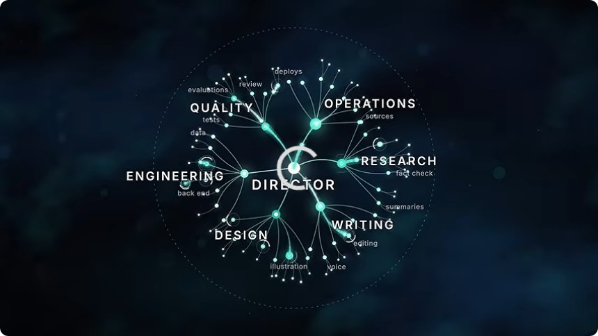
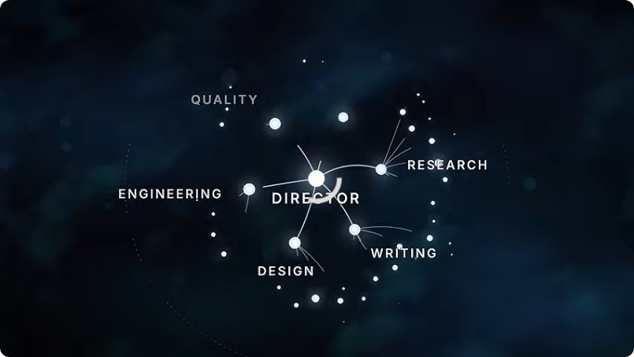

# How the Pros Actually Work With AI: The Director Pattern & Agentic Ontology Graph

> **Reference Material:** Based on the masterclass by Matt Maher:  
> 🔗 [Watch on YouTube: "How the Pros Actually Work With AI Now" (Timestamp: 5m 55s / 355s)](https://www.youtube.com/watch?v=KbuSHtTeyEA&t=355s)

---

## Executive Summary

Most practitioners interact with Artificial Intelligence in a single conversational thread—an anti-pattern known as **"Stuck in the Main Loop"**. In this flawed setup, a single prompt stream is forced to handle broad brainstorming, architecture, line-by-line coding, debugging, documentation, and quality review. The resulting context window suffers from context drift, token bloat, rate-limit bottlenecks, and hallucinations.

The breakthrough paradigm used by top AI engineers and agent architects is the **Director Pattern**, orchestrated over an **Agentic Ontology Graph**. 

```
                                  +-------------------+
                                  |     HUMAN USER    |
                                  +---------+---------+
                                            | (Natural conversation)
                                            v
                                  +-------------------+
                                  |   [DIRECTOR] 🎬   |
                                  |   Orchestrator    |
                                  +---------+---------+
                                            |
         +-----------------+----------------+-----------------+-----------------+
         |                 |                |                 |                 |
         v                 v                v                 v                 v
+-----------------+ +---------------+ +---------------+ +---------------+ +---------------+
|   ENGINEERING   | |    DESIGN     | |    WRITING    | |   RESEARCH    | |  OPERATIONS   |
| (Backend, Data) | |  (UI/Layout)  | | (Docs, Copy)  | | (Fact checks) | |  (Deployments)|
+--------+--------+ +-------+-------+ +-------+-------+ +-------+-------+ +-------+-------+
         \                  \               |               /                  /
          +------------------+--------------+--------------+------------------+
                                            |
                                            v
                                  +-------------------+
                                  |   QUALITY / EVAL  |
                                  |  (Tests, Gates)   |
                                  +-------------------+
```

Instead of building rigid, over-engineered "agent factories" up front, high-performing systems start with **one empty directory, one conversational director that deliberately avoids doing manual tasks, and a small cluster of specialized sub-agent roles**.

---

## 1. The Core Philosophy: "Factories Are Simple"

> *"Those big agentic systems people are calling agent factories don't start big. They start with one agent you keep talking to, one that doesn't do the work, and a few roles that do."*  
> — **Matt Maher**


### Key Rules of the Professional AI Setup

1. **The Director Never Touches the Shovel:** The primary agent's responsibility is conversational alignment with the human, problem decomposition, task queuing, and role delegation. It protects its high-level reasoning bandwidth.
2. **Distinct Roles with Hard Boundaries:** Each sub-agent is assigned an isolated system prompt, specific toolsets, and scoped deliverables. They do not cross into other domains.
3. **Adaptive Intelligence Tiering (Model Routing):** The Director routes tasks according to cognitive demand:
   - *High-order synthesis / architecture:* Frontier models (Claude 3.7 / 3.5 Sonnet, GPT-4o, Gemini 1.5 Pro).
   - *Repetitive data extraction / formatting / linting:* Lightweight, fast, low-cost models (Haiku, Flash, GPT-4o-mini).
4. **Continuous Parallel Feedback Loop:** While sub-agents execute in background worker threads, the Director remains immediately available to chat with the human, reporting real-time status updates and accepting mid-flight scope modifications.

---

## 2. The Ontology Graph Architecture

At **05:55 (355s)** in the video, Matt Maher presents the fundamental ontology graph connecting the Director with specialized functional domains:



### Node Breakdown & Domain Responsibilities

| Node Domain | Sub-capabilities / Verticals | Primary Responsibilities | Suggested Model Tier |
| :--- | :--- | :--- | :--- |
| **DIRECTOR** 🎬 | Orchestration, decomposition, dispatch | Maintains user dialog, translates requests into tasks, manages sub-agent lifecycle, monitors progress. | Frontier / Maximum Reasoning |
| **ENGINEERING** | Back-end, data pipelines, APIs, logic | Implements server-side code, database migrations, state machines, business logic. | High Reasoning / Coding Specialist |
| **DESIGN** | Illustration, UI/UX, components, styles | Builds frontend templates, visual assets, layouts, typography, responsiveness. | High Multimodal / Vision |
| **WRITING** | Documentation, voice, editing, copy | Drafts technical manuals, user guides, localization text, commit notes. | High Linguistic Fluency |
| **RESEARCH** | Fact-checking, summaries, web exploration | Scrapes documentation, searches web libraries, verifies APIs, collects domain data. | Fast / Large Context |
| **OPERATIONS** | Deployments, CI/CD, sources, environments | Manages package installations, builds, containerization, environment secrets. | Fast / Tool-Execution Heavy |
| **QUALITY** | Evaluations, tests, linting, review | Executes test suites, verifies gate conditions, assesses visual regressions. | High Precision / Analytical |

---

## 3. The Canonical Director Request (The 2:45 / 3:55 Prompt)

Below is the verbatim prompt revealed by Matt Maher to instantiate the Director Pattern inside an agentic terminal (such as Claude Code, Cursor, or Gemini Agentic Shell):

```markdown
Okay, I want you to create a director pattern here, so that the main agent 
that I start talking to is what I call a director. And I want you to use a 
little clapboard emoji (🎬) whenever that director talks to us, just so that 
we know we're talking to the director, if you don't mind.

But what I want the director to be able to do is, its job is to be very 
intelligent and to be a co-partner in what we're trying to solve. So it needs 
to be creative and interested in solving the problem, but it needs to try to 
NOT do the work. 

Its job is to have a conversation with me, and always be available to have a 
conversation with me, and use sub-agent patterns to create new workers as 
needed to do the different roles for the work that is needing to be done. 

So when a request comes in, the director will figure out what that request 
is and break it down intelligently.

Now, the director also has the capacity to tune those different sub-agents 
that it's bringing up to use different levels of intelligence. So it can use 
a very small model if it's asking to do something that's very lightweight, 
or a more intelligent model if it thinks that it's doing something that needs 
some creativity or some more reasoning behind it. So that's a really important 
aspect of what this director does.

And one other thing that it does is it reports back to me on a regular basis. 
While sub-agents are still running, the director thread is always running and 
reporting back on a regular basis what's going on and what the status of those 
sub-agents are.
```

---

## 4. Step-by-Step Implementation Guide

### Step 1: Initialize in a Clean Directory
Never load a massive legacy codebase into an agent's root memory without boundary definitions. Start in a fresh workspace:
```bash
mkdir agent-director-system
cd agent-director-system
```

### Step 2: Establish the Roles Registry (`roles.json` / `agents.md`)
Define the contract for each sub-agent so the Director can spawn them with explicit system prompts:

```json
{
  "director": {
    "role": "Orchestrator and User Partner",
    "prefix": "🎬",
    "can_write_code": false,
    "can_spawn_agents": true
  },
  "researcher": {
    "role": "Information Gathering & Fact Extraction",
    "tools": ["web_search", "read_file", "fetch_url"],
    "model_tier": "fast"
  },
  "engineer": {
    "role": "Implementation Specialist",
    "tools": ["write_file", "edit_file", "run_command"],
    "model_tier": "pro"
  },
  "evaluator": {
    "role": "Quality Gate & Acceptance Tester",
    "tools": ["run_command", "read_file"],
    "model_tier": "pro"
  }
}
```

### Step 3: Incremental Scaling (The Travel Poster Example)
In the live demonstration, the author demonstrates how a multi-agent system naturally emerges from a basic user goal:
1. **User asks for:** *"Generate vintage travel posters for fictitious planetary destinations."*
2. **Director decomposes:**
   - Dispatches `Researcher` to extract climate, terrain, and color palettes for 5 planets.
   - Dispatches `Copywriter` to draft catchy slogans and retro tourism taglines.
   - Dispatches `Designer / Engineer` to compose SVG / Canvas code in parallel.
3. **Mid-Flight Scope Modification (At 17:08):**
   - While workers are midway through generation, the user instructs the Director: *"Wait, make the fonts Art Deco and add a neon glow."*
   - Because the Director is decoupled from the rendering loop, it immediately intercepts the pipeline, passes updated design constraints to active sub-agents, and queues the revision without crashing the session.



### Step 4: Adding the Evaluator / Quality Gate
Rather than human-verifying 50 generated artifacts, create an `Evaluator` role. The Evaluator inspects generated code against strict criteria:
- Valid SVG syntax / zero syntax errors.
- Correct aspect ratios (e.g., 2:3 poster format).
- Consistent color theme matching the planetary brief.

Artifacts that fail the gate are sent back to the respective sub-agent with targeted feedback, insulating the user from raw failure states.

---

## 5. Practical Checklist for Production AI Workflows

- [x] **Decouple Thinking from Typing:** Ensure the orchestrating agent is not bogged down writing 500 lines of boilerplate while you are trying to brainstorm the next phase.
- [x] **Asynchronous Execution:** Worker agents run in parallel threads or background subprocesses.
- [x] **Context Hygiene:** Never feed entire repository dumps into every sub-agent. Give each sub-agent only the precise interface definitions, files, or research notes it needs.
- [x] **Distinct Visual Signals:** Use distinctive prefixes (e.g. `🎬 Director:`, `🔬 Researcher:`, `🛠️ Engineer:`) to maintain clear situational awareness in multi-agent console streams.
- [x] **Cost Optimization:** Route routine linting, text formatting, and simple regex queries to cost-effective models; reserve large reasoning models for high-stakes orchestration and code generation.

---

## 6. Video Chapter Index

For deep-dive reference, the key milestones from Matt Maher's session:
- **00:00** — Agent systems, or factories
- **01:05** — Stuck in the main loop
- **02:08** — Start with an empty folder
- **02:24** — Asking for a director
- **02:45** — The director request
- **04:44** — Why separate the work
- **05:55** — The Director Ontology Graph (Visual breakdown)
- **06:45** — "I'm your director"
- **07:12** — Defining the roles
- **09:25** — What a role really is
- **12:02** — The roles at work
- **15:12** — Adding responsibility mid-run
- **17:08** — Changing work in flight
- **19:00** — Queuing more work
- **21:43** — You build it as you go
- **23:21** — Directors of directors
- **24:14** — The Poster Gallery output
- **25:20** — A partner and a couple of roles
- **26:20** — Point your agent at this video
